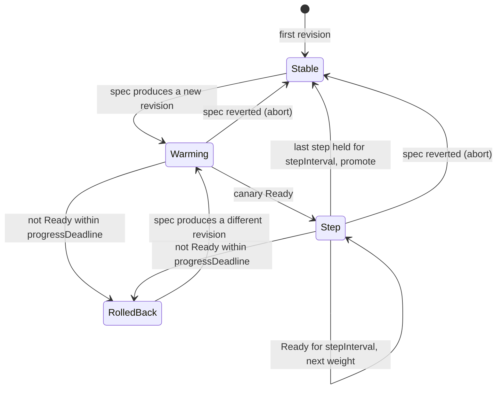

# llm-deployment-operator

A Kubernetes operator, written in Go with controller-runtime, that rolls out Llama and Qwen
models on [KServe](https://kserve.github.io/website/)'s `LLMInferenceService` with vLLM. For
each `ModelDeployment` it:

- picks the highest-quality checkpoint (fp16, GPTQ or AWQ) whose estimated memory fits the GPU
  budget, and the smallest MIG profile that holds it;
- claims one MIG instance per replica through Dynamic Resource Allocation (DRA) with a
  `ResourceClaimTemplate` for the NVIDIA DRA driver;
- rolls out changes as a weighted canary behind a Gateway API `HTTPRoute`, promoting or rolling
  back automatically;
- reverts out-of-band edits to the objects it owns, and
- enforces per-tenant MIG quotas.

With an 8192-token context and 8 concurrent sequences, a 4-bit Llama-3.1-8B replica is estimated
at 14.83 GiB, which fits a `1g.20gb` MIG instance, so one A100-80GB holds four replicas (see
[the memory math](#how-variant-and-mig-selection-works)).

> **Project status.** This is an early-stage project. The planner, packing, rollout and quota
> logic are covered by unit tests, and the reconcilers are tested against controller-runtime's
> fake client. **No test has been run against a live cluster** with KServe, the NVIDIA DRA driver
> or a Gateway. See [What was and wasn't tested](#what-was-and-wasnt-tested).

## Contents

- [Architecture](#architecture)
- [Example](#example)
- [How variant and MIG selection works](#how-variant-and-mig-selection-works)
- [MIG packing and packsim](#mig-packing-and-packsim)
- [DRA claims](#dra-claims)
- [KServe LLMInferenceService](#kserve-llminferenceservice)
- [Canary rollouts](#canary-rollouts)
- [Drift correction](#drift-correction)
- [Per-tenant quota](#per-tenant-quota)
- [Status](#status)
- [Installing](#installing)
- [Development](#development)
- [What was and wasn't tested](#what-was-and-wasnt-tested)
- [Limitations and known gaps](#limitations-and-known-gaps)

## Architecture

```mermaid
flowchart LR
    MD["ModelDeployment<br/>(namespaced)"] --> R
    TQ["TenantQuota<br/>(cluster-scoped)"] --> R
    subgraph operator["llm-deployment-operator"]
        R["ModelDeployment<br/>reconciler"]
        PL["planner<br/>(memory estimate, variant + MIG profile)"]
        SM["rollout state machine<br/>(canary steps, promote, rollback)"]
        Q["quota check"]
        TQR["TenantQuota<br/>reconciler"]
        R --> PL
        R --> SM
        R --> Q
    end
    R -->|one per revision| CR["ControllerRevision<br/>(revision snapshot)"]
    R -->|one per revision| RCT["ResourceClaimTemplate<br/>resource.k8s.io/v1"]
    R -->|one per revision| LIS["LLMInferenceService<br/>serving.kserve.io/v1alpha1"]
    R -->|one per deployment| HR["HTTPRoute<br/>gateway.networking.k8s.io/v1"]
    MD -. status.allocatedSlices .-> TQR
    TQR -->|status.usedSlices| TQ
    LIS -->|KServe| POD["vLLM pods, InferencePool,<br/>endpoint picker"]
    RCT -->|DRA scheduler +<br/>NVIDIA DRA driver| MIG["MIG instance<br/>(e.g. 1g.20gb)"]
    POD --- MIG
    HR -->|weighted backendRefs| POD
```

A *revision* is the hash of everything that is rolled out: model name, chosen variant (URI,
quantization, bits), GPU type, MIG profile, `maxModelLen`, `maxConcurrentSequences`, image, extra
args and env. Replica count is not part of it, so scaling happens in place. For every live revision
the operator owns:

| Object | Name | Purpose |
|---|---|---|
| `apps/v1` `ControllerRevision` | `<deployment>-<rev>` | Snapshot of the revision, so the stable revision can still be rendered (and its drift corrected) while the spec has moved on to a canary. |
| `resource.k8s.io/v1` `ResourceClaimTemplate` | `<deployment>-<rev>-mig` | One MIG instance of the planned profile per pod. |
| `serving.kserve.io/v1alpha1` `LLMInferenceService` | `<deployment>-<rev>` | vLLM workload; KServe creates the pods, the InferencePool and the endpoint picker. |

plus one Gateway API `HTTPRoute` named `<deployment>` that splits traffic between the stable and
canary revisions. Everything carries an owner reference to the `ModelDeployment` and is watched
with `Owns()`, so changes to it trigger a reconcile.

Code layout:

| Path | Contents |
|---|---|
| `api/v1alpha1` | `ModelDeployment` and `TenantQuota` types (group `serving.llmops.dev`) |
| `internal/planner` | Model catalog, memory estimate, variant and profile choice (pure) |
| `internal/packing` | MIG profile tables and first-fit-decreasing packing (pure) |
| `internal/rollout` | Canary/recreate state machine (pure) |
| `internal/quota` | Quota arithmetic (pure) |
| `internal/render` | Builds the `ResourceClaimTemplate`, `LLMInferenceService` and `HTTPRoute` |
| `internal/controller` | Reconcilers, drift-aware apply, metrics, field indexes |
| `cmd/manager` | Operator entrypoint (metrics, health probes, leader election) |
| `cmd/packsim` | Static fleet allocation calculator |

## Example

[`config/samples/serving_v1alpha1_modeldeployment_llama.yaml`](config/samples/serving_v1alpha1_modeldeployment_llama.yaml):

```yaml
apiVersion: serving.llmops.dev/v1alpha1
kind: ModelDeployment
metadata:
  name: llama-chat
  namespace: team-a
spec:
  tenant: team-a
  model:
    family: llama
    name: meta-llama/Llama-3.1-8B-Instruct
    catalogRef: llama-3.1-8b        # or spec.model.architecture for a model not in the catalog
  variants:
    - quantization: fp16
      uri: hf://meta-llama/Llama-3.1-8B-Instruct
    - quantization: awq
      uri: hf://hugging-quants/Meta-Llama-3.1-8B-Instruct-AWQ-INT4
    - quantization: gptq
      bits: 4
      uri: hf://hugging-quants/Meta-Llama-3.1-8B-Instruct-GPTQ-INT4
  gpuBudget:
    gpuType: A100-80GB              # A100-80GB | A100-40GB | H100-80GB
    maxMemoryGiBPerReplica: 20      # only profiles with at most 20 GiB are considered
    maxModelLen: 8192
    maxConcurrentSequences: 8
  replicas: 4
  runtime:
    image: vllm/vllm-openai:v0.10.1
    extraArgs: ["--enable-prefix-caching"]
    env:
      - name: HF_TOKEN
        valueFrom: {secretKeyRef: {name: hf-token, key: token}}
  rollout:
    strategy: Canary                # or Recreate
    steps: [10, 50, 100]
    stepInterval: 5m
    progressDeadline: 30m
```

The planner chooses AWQ on `1g.20gb`. This is the `Planned` condition message the reconciler
produces for this sample:

```
awq-int4 on 1g.20gb: estimated 14.83 GiB (weights 5.33, KV cache 8.00, overhead 1.50) of 17.55 GiB usable; 4 replicas per A100-80GB
```

and these are the objects it renders for revision `90f334cc` (output of `internal/render` for the
sample; owner references omitted). The HTTPRoute is shown at the 10% canary step after the image
is changed to `vllm/vllm-openai:v0.11.0`, which produces revision `db45f654`:

```yaml
apiVersion: resource.k8s.io/v1
kind: ResourceClaimTemplate
metadata:
  name: llama-chat-90f334cc-mig
  namespace: team-a
spec:
  spec:
    devices:
      requests:
      - name: mig
        exactly:
          deviceClassName: mig.nvidia.com
          allocationMode: ExactCount
          count: 1
          selectors:
          - cel:
              expression: device.attributes['gpu.nvidia.com'].profile == '1g.20gb'
          - cel:
              expression: device.attributes['gpu.nvidia.com'].productName.matches('A100.*80GB')
---
apiVersion: serving.kserve.io/v1alpha1
kind: LLMInferenceService
metadata:
  name: llama-chat-90f334cc
  namespace: team-a
spec:
  model:
    name: meta-llama/Llama-3.1-8B-Instruct
    uri: hf://hugging-quants/Meta-Llama-3.1-8B-Instruct-AWQ-INT4
  replicas: 4
  router:
    gateway:
      refs: [{name: kserve-ingress-gateway, namespace: kserve}]
    route:
      http:
        refs: [{name: llama-chat}]   # the operator's HTTPRoute; KServe does not create its own
    scheduler: {}                    # KServe creates the InferencePool and endpoint picker
  template:
    containers:
    - name: main
      image: vllm/vllm-openai:v0.10.1
      command: [vllm, serve, /mnt/models]
      args: [--served-model-name, meta-llama/Llama-3.1-8B-Instruct, --port, "8000",
             --quantization, awq_marlin, --max-model-len, "8192", --max-num-seqs, "8",
             --gpu-memory-utilization, "0.90", --enable-prefix-caching]
      env:
      - name: HF_TOKEN
        valueFrom: {secretKeyRef: {key: token, name: hf-token}}
      resources:
        claims: [{name: mig}]
    resourceClaims:
    - name: mig
      resourceClaimTemplateName: llama-chat-90f334cc-mig
---
apiVersion: gateway.networking.k8s.io/v1
kind: HTTPRoute
metadata:
  name: llama-chat
  namespace: team-a
spec:
  parentRefs:
  - {group: gateway.networking.k8s.io, kind: Gateway, name: kserve-ingress-gateway, namespace: kserve}
  rules:
  - matches:
    - path: {type: PathPrefix, value: /team-a/llama-chat}
    filters:
    - type: URLRewrite
      urlRewrite: {path: {type: ReplacePrefixMatch, replacePrefixMatch: /}}
    backendRefs:
    - {group: inference.networking.k8s.io, kind: InferencePool, name: llama-chat-90f334cc-inference-pool, weight: 90}
    - {group: inference.networking.k8s.io, kind: InferencePool, name: llama-chat-db45f654-inference-pool, weight: 10}
```

Clients call `/<namespace>/<deployment>/v1/chat/completions` on the Gateway; the prefix is stripped,
so the OpenAI-compatible paths and the served model name stay the same across revisions.

Other samples: a Qwen2.5-7B deployment with default rollout settings
([`serving_v1alpha1_modeldeployment_qwen.yaml`](config/samples/serving_v1alpha1_modeldeployment_qwen.yaml))
and a `TenantQuota` ([`serving_v1alpha1_tenantquota.yaml`](config/samples/serving_v1alpha1_tenantquota.yaml)).

## How variant and MIG selection works

### Memory estimate

For each variant the planner (`internal/planner`) estimates the memory of one vLLM replica:

```
weights   = params x 2 bytes                                          (fp16)
          = (params - embedding_params) x (bits + (16 + bits)/128) / 8
            + embedding_params x 2 bytes                              (AWQ / GPTQ)
kv_cache  = 2 x layers x kv_heads x head_dim x 2 bytes x maxModelLen x maxConcurrentSequences
overhead  = 1.5 GiB
estimate  = weights + kv_cache + overhead
```

- `embedding_params` is `vocab_size x hidden_size`, doubled when the LM head is not tied. AWQ and
  GPTQ checkpoints keep the embedding and LM head in 16-bit.
- `(16 + bits)/128` is each weight's share of its quantization group's 16-bit scale and packed
  zero point, for the usual group size of 128. 4-bit weights therefore cost 4.15625 bits and 8-bit
  GPTQ weights 8.1875 bits.
- The KV cache is sized for the worst case: every concurrent sequence at `maxModelLen`, with the
  default 16-bit KV cache, so a replica never has to preempt sequences at the configured load.
- `overhead` is a fixed allowance for the CUDA context, the activation workspace vLLM profiles at
  startup, and CUDA graphs. It is an assumption, not a measurement; calibrate it for your vLLM
  version.

A variant fits a MIG profile when `estimate <= 0.90 x profile memory`; 0.90 is also passed to vLLM
as `--gpu-memory-utilization`, so vLLM gives any memory above the estimate to additional KV cache
blocks.

The built-in catalog (`spec.model.catalogRef`) holds the dimensions from each model's `config.json`:

| catalogRef | params | layers | KV heads | head dim | hidden | vocab | context |
|---|---|---|---|---|---|---|---|
| `llama-3.1-8b` | 8,030,261,248 | 32 | 8 | 128 | 4096 | 128,256 | 131,072 |
| `llama-3.1-70b` | 70,553,706,496 | 80 | 8 | 128 | 8192 | 128,256 | 131,072 |
| `qwen2.5-7b` | 7,615,616,512 | 28 | 4 | 128 | 3584 | 152,064 | 32,768 |
| `qwen2.5-14b` | 14,770,033,664 | 48 | 8 | 128 | 5120 | 152,064 | 32,768 |
| `qwen2.5-72b` | 72,706,203,648 | 80 | 8 | 128 | 8192 | 152,064 | 32,768 |

Other models can be described inline with `spec.model.architecture`.

### Worked example: Llama-3.1-8B on an A100-80GB

Output of `go run ./cmd/packsim -explain llama-3.1-8b` (a static calculation; nothing is loaded):

```
llama-3.1-8b on A100-80GB, max-model-len=8192 max-num-seqs=8
parameters: 8030261248, of which embedding + LM head (kept in 16-bit when quantized): 1050673152
KV cache: 2 x 32 layers x 8 KV heads x 128 head dim x 2 bytes = 131072 bytes/token, x 65536 tokens

VARIANT    WEIGHTS  KV CACHE  OVERHEAD  ESTIMATE  SMALLEST PROFILE  PROFILE USABLE  PER GPU
fp16       14.96    8.00      1.50      24.46     3g.40gb           35.33           2
gptq-int8  8.61     8.00      1.50      18.11     3g.40gb           35.33           2
awq-int4   5.33     8.00      1.50      14.83     1g.20gb           17.55           4
gptq-int4  5.33     8.00      1.50      14.83     1g.20gb           17.55           4
(memory in GiB; PROFILE USABLE is 90% of the profile's memory)
```

The 4-bit estimate of 14.83 GiB is below 90% of the 19.5 GiB a `1g.20gb` instance provides
(17.55 GiB), and above what `1g.10gb` provides (8.55 GiB). An A100-80GB can be split into at most
four `1g.20gb` instances, so it hosts four replicas. The fp16 checkpoint (24.46 GiB) and the 8-bit
GPTQ one (18.11 GiB) need `3g.40gb`; with `maxMemoryGiBPerReplica: 20` they are excluded, which is
how the sample ends up on AWQ.

The same calculation for `qwen2.5-7b` (4 KV heads, so 56 KiB per token) gives 10.19 GiB for 4-bit
and 13.25 GiB for 8-bit GPTQ, both on `1g.20gb`, and 19.19 GiB for fp16 (`3g.40gb`).

### Choosing a variant and profile

1. Candidate profiles are the GPU's MIG profiles whose usable memory is at most
   `maxMemoryGiBPerReplica` (all of them when it is unset), ordered by memory and then by compute
   slices, so `1g.20gb` is preferred over `2g.20gb`.
2. Variants are tried from highest to lowest quality, and the first one that fits a candidate
   profile wins, on the smallest profile it fits. The order is deterministic:
   1. more weight bits first (fp16, then 8-bit, then 4-bit);
   2. then the smaller estimate;
   3. then **AWQ before GPTQ**;
   4. then the order in `spec.variants`.

   AWQ and GPTQ at 4 bits have the same estimate in this model, so rule 3 decides between them.
   It is a fixed convention that keeps plans stable across reconciles, not a claim that one
   method is better; list only the variant you want if you prefer GPTQ.
3. If nothing fits, the `Planned` condition is `False` with the estimate of every variant, the
   phase is `Failed`, and running revisions are left untouched.

## MIG packing and packsim

`internal/packing` holds MIG profile tables for A100-80GB, A100-40GB and H100-80GB (compute-only
profiles; the `+me` media variants are omitted). Each GPU has 7 compute slices and 8 memory
slices. For A100-80GB:

| profile | compute slices | memory slices | usable GiB | max per GPU | placements (memory-slice offsets) |
|---|---|---|---|---|---|
| `1g.10gb` | 1 | 1 | 9.5 | 7 | 0-6 |
| `1g.20gb` | 1 | 2 | 19.5 | 4 | 0, 2, 4, 6 |
| `2g.20gb` | 2 | 2 | 19.5 | 3 | 0, 2, 4 |
| `3g.40gb` | 3 | 4 | 39.25 | 2 | 0, 4 |
| `4g.40gb` | 4 | 4 | 39.25 | 1 | 0 |
| `7g.80gb` | 7 | 8 | 78.75 | 1 | 0 |

Usable memory is approximately what `nvidia-smi mig -lgip` reports; it varies slightly by driver.
`Pack` places replica requests with first-fit decreasing: requests are sorted by memory slices,
then compute slices, then ID; each goes to the first GPU that has a free valid placement, the
compute slices, and room under the profile's instance limit.

The operator itself does not place MIG instances; the DRA scheduler does that. Packing is used by
`cmd/packsim`, which compares a sample fleet (defined in `cmd/packsim/main.go`) under two
allocation schemes. Output of `go run ./cmd/packsim`:

```
Static allocation calculation: per-replica memory comes from the planner's estimate
(weights + KV cache for max-num-seqs sequences at max-model-len + fixed runtime overhead).
No model was loaded and no GPU utilization was measured.

GPU A100-80GB: 80 GiB, 7 compute slices, 8 memory slices
max-model-len=8192 max-num-seqs=8 gpu-memory-utilization=0.90

WORKLOAD                 REPLICAS  VARIANT    WEIGHTS  KV CACHE  OVERHEAD  ESTIMATE  MIG PROFILE  PER GPU
llama-3.1-8b-chat        8         awq-int4   5.33     8.00      1.50      14.83     1g.20gb      4
qwen2.5-7b-assistant     6         awq-int4   5.19     3.50      1.50      10.19     1g.20gb      4
qwen2.5-14b-rag          3         gptq-int4  9.29     12.00     1.50      22.79     3g.40gb      2
llama-3.1-70b-reasoning  2         awq-int4   37.03    20.00     1.50      58.53     7g.80gb      1
qwen2.5-72b-batch        1         gptq-int4  38.61    20.00     1.50      60.11     7g.80gb      1
(memory in GiB)

ALLOCATION                         GPUS  REPLICAS  ESTIMATE / GPU MEMORY  MIG MEMORY / GPU MEMORY  COMPUTE SLICES IN USE
one replica per whole GPU          20    20        26.6%                  -                        -
MIG-packed (first-fit decreasing)  8     20        66.5%                  100.0%                   44/56

ESTIMATE / GPU MEMORY: sum of per-replica estimates / total memory of the GPUs needed.
MIG MEMORY / GPU MEMORY: nominal memory of the allocated MIG instances / total memory of the GPUs needed.

MIG layout:
  gpu0  7g.80gb@0 llama-3.1-70b-reasoning/0
  gpu1  7g.80gb@0 llama-3.1-70b-reasoning/1
  gpu2  7g.80gb@0 qwen2.5-72b-batch/0
  gpu3  3g.40gb@0 qwen2.5-14b-rag/0, 3g.40gb@4 qwen2.5-14b-rag/1
  gpu4  3g.40gb@0 qwen2.5-14b-rag/2, 1g.20gb@4 llama-3.1-8b-chat/0, 1g.20gb@6 llama-3.1-8b-chat/1
  gpu5  1g.20gb@0 llama-3.1-8b-chat/2, 1g.20gb@2 llama-3.1-8b-chat/3, 1g.20gb@4 llama-3.1-8b-chat/4, 1g.20gb@6 llama-3.1-8b-chat/5
  gpu6  1g.20gb@0 llama-3.1-8b-chat/6, 1g.20gb@2 llama-3.1-8b-chat/7, 1g.20gb@4 qwen2.5-7b-assistant/0, 1g.20gb@6 qwen2.5-7b-assistant/1
  gpu7  1g.20gb@0 qwen2.5-7b-assistant/2, 1g.20gb@2 qwen2.5-7b-assistant/3, 1g.20gb@4 qwen2.5-7b-assistant/4, 1g.20gb@6 qwen2.5-7b-assistant/5
```

What these numbers mean: for this made-up fleet, giving every replica a whole GPU needs 20 GPUs,
and the planner's estimates add up to 26.6% of their memory. Packing the same replicas onto MIG
instances needs 8 GPUs, and the same estimates add up to 66.5% of those GPUs' memory. This is
arithmetic over the planner's estimates and the MIG tables. It says nothing about achieved
throughput, latency, or measured GPU utilization, none of which were measured. (In practice vLLM
on a whole GPU would also reserve 90% of it for KV cache; the comparison counts only the memory
the configured load needs.) Use `-gpu`, `-max-model-len` and `-max-num-seqs` to change the inputs.

## DRA claims

Each revision gets a `resource.k8s.io/v1` `ResourceClaimTemplate` (the DRA API that is GA in
Kubernetes 1.34 and served by the `k8s.io/api` v0.34 types this project builds against). Each pod
of the `LLMInferenceService` references it in `spec.template.resourceClaims`, the `main` container
in `resources.claims`, and DRA creates one `ResourceClaim` per pod.

The request asks for exactly one device of class `mig.nvidia.com`, the DeviceClass that NVIDIA's
[k8s-dra-driver-gpu](https://github.com/NVIDIA/k8s-dra-driver-gpu) creates for MIG devices, with two
CEL selectors on the attributes that driver publishes under the `gpu.nvidia.com` domain:

- `device.attributes['gpu.nvidia.com'].profile == '1g.20gb'` pins the MIG profile;
- `device.attributes['gpu.nvidia.com'].productName.matches('A100.*80GB')` pins the GPU model,
  because the same profile name (for example `1g.20gb`) exists on both A100-80GB and H100-80GB with
  different performance. The patterns are `A100.*80GB`, `A100.*40GB` and `H100`.

The attribute names (`profile`, `productName`) are taken from the driver's MIG device attributes
but were not verified against a running driver. If your driver version names them differently,
change `MIGSelectors` in `internal/render/render.go`. The selectors assume MIG
instances already exist on the node (static MIG partitioning, for example via the GPU operator's
MIG manager).

## KServe LLMInferenceService

`LLMInferenceService` (`serving.kserve.io/v1alpha1`) is created as `unstructured.Unstructured`; the
operator does not import KServe's Go module. The fields it sets are `spec.model.uri` and
`spec.model.name`, `spec.replicas`, `spec.router` (`scheduler: {}` so that KServe creates the
InferencePool and endpoint picker, `gateway.refs`, and `route.http.refs` pointing at the operator's
HTTPRoute), and `spec.template` (a pod spec) with the `main` container and the DRA claim.

vLLM arguments:

| Argument | Value |
|---|---|
| `--quantization` | `awq_marlin` for AWQ, `gptq_marlin` for GPTQ, omitted for fp16. All three GPU types are Ampere or newer, where vLLM's Marlin kernels apply; passing plain `awq` or `gptq` would make vLLM use the slower non-Marlin kernels. |
| `--max-model-len` | `gpuBudget.maxModelLen` |
| `--max-num-seqs` | `gpuBudget.maxConcurrentSequences` |
| `--gpu-memory-utilization` | `0.90` |
| `--served-model-name`, `--port` | `spec.model.name`, `8000` |

followed by `runtime.extraArgs`. The operator sets the full command (`vllm serve /mnt/models`) and
argument list, because container args are replaced, not merged, when KServe merges the template
with its `LLMInferenceServiceConfig`. If your KServe configuration serves vLLM over TLS, add the
`--ssl-certfile`/`--ssl-keyfile` flags through `runtime.extraArgs`. If your default
`LLMInferenceServiceConfig` sets `nvidia.com/gpu` limits, remove them: the pod should get its GPU
from the DRA claim, not the device plugin.

The HTTPRoute's backends are the InferencePools KServe creates, assumed to be named
`<llminferenceservice>-inference-pool` in API group `inference.networking.k8s.io`. Use the
`--inference-pool-api-group` flag (Helm value `inferencePoolAPIGroup`) for KServe versions that
still use `inference.networking.x-k8s.io`.

## Canary rollouts

The rollout logic is a pure state machine in `internal/rollout` (`rollout.Next`); the reconciler
persists its state in the `ModelDeployment` status and requeues with `RequeueAfter` for the next
time-based transition. Readiness changes of the canary arrive through the `Owns()` watch.



- **Start.** When the spec produces a new revision, the stable `LLMInferenceService` stays and a
  canary one is created next to it, with `ceil(replicas x weight / 100)` replicas (at least one)
  for the weight of the step it is at; a 10% step of 4 replicas runs 1 canary replica. While it
  warms up it gets no traffic (`canaryStep: -1`).
- **Advance.** Once KServe reports the canary `Ready`, it gets the first step's weight in the
  HTTPRoute. After it has stayed Ready for `stepInterval`, it moves to the next step. If it stops
  being Ready its weight drops to 0 immediately.
- **Promote.** After `stepInterval` at the last step (100%), the canary becomes stable and the old
  stable revision's `LLMInferenceService`, `ResourceClaimTemplate` and `ControllerRevision` are
  deleted.
- **Roll back.** If the canary is not Ready within `progressDeadline` of the start of the current
  step, its weight is set to 0, its objects are deleted, the `RolledBack` condition is set, and a
  Warning event is recorded. The failed revision is not retried until the spec changes to a
  different revision.
- **Abort.** If the spec is changed back to the stable revision, the canary is removed. If it is
  changed to a third revision, that one replaces the canary and starts over.
- **Recreate.** With `strategy: Recreate`, the new revision replaces the stable one at once.

The first revision of a deployment is always deployed directly.

## Drift correction

Child objects are reconciled with get, compare and update. The rendered object is treated as the
set of fields the operator owns: the live object is in sync when every rendered field (maps
recursively, lists element by element) has the same value, so fields added by KServe, defaulting
webhooks or other controllers are left alone. Otherwise the operator writes its spec back (field
manager `llm-deployment-operator`). `ResourceClaimTemplate` specs are immutable, so those are
deleted and recreated.

A change counts as **drift** when the live object still carries the operator's
`serving.llmops.dev/spec-hash` annotation for the desired spec: the operator did not change its
intent, so someone else changed the object. Drift corrections record a `DriftCorrected` Warning
event on the `ModelDeployment` and increment the Prometheus counter
`llmdeploy_drift_corrections_total{kind="LLMInferenceService"|"HTTPRoute"|"ResourceClaimTemplate"}`.
Updates caused by spec changes (for example scaling) are not counted. Deleted children are
recreated.

When an update is needed, the operator replaces the whole `spec` with the rendered one, so fields
that other writers added to `spec` are dropped at that point (defaulting webhooks add theirs back
on the update). Server-side apply would merge instead; it was not used so that the exact update
semantics are the ones exercised by the fake-client tests.

## Per-tenant quota

A cluster-scoped `TenantQuota` limits MIG instances per profile and/or total MIG memory for a
tenant, counting every revision, canaries included:

```yaml
apiVersion: serving.llmops.dev/v1alpha1
kind: TenantQuota
metadata:
  name: team-a
spec:
  tenant: team-a
  migSlices:
    - {profile: 1g.20gb, max: 8}
    - {profile: 3g.40gb, max: 2}
  maxGPUMemoryGiB: 160    # nominal: 20 per 1g.20gb, 40 per 3g.40gb, 80 per 7g.80gb
```

- Each `ModelDeployment` records the slices it holds in `status.allocatedSlices`. Both types are
  indexed by `spec.tenant`.
- Before applying a change that would grow its allocation (creation, scale-up, starting a canary,
  advancing it), the reconciler adds the allocations of the tenant's other deployments and checks
  every `TenantQuota` of the tenant. If any limit would be exceeded it does not apply the
  increase: nothing is created for a new deployment, running revisions keep their current replica
  count, and the canary does not start or advance. The `QuotaExceeded` condition says why, for
  example
  `TenantQuota team-a: 1g.20gb slices would be 8 (this deployment 4 + other deployments 4), limit 6`.
- Decreases are always applied, and lowering a quota never evicts running replicas.
- Profiles not listed in `migSlices` are bound only by `maxGPUMemoryGiB`. A tenant with no
  `TenantQuota` is not limited.
- The `TenantQuota` reconciler keeps `status.usedSlices`, `status.usedGPUMemoryGiB` and
  `status.deployments` current. Changes to a quota or its usage requeue the tenant's deployments,
  so blocked ones retry when capacity frees up.

A canary needs quota headroom for its extra replicas. Use `strategy: Recreate` for a tenant that
runs at its limit.

## Status

`kubectl get modeldeployments` (short name `mdep`) shows the tenant, variant, MIG profile,
replicas, canary weight and phase.

| Field | Meaning |
|---|---|
| `phase` | `Pending`, `Progressing` (canary in flight), `Ready`, `Failed` (no plan) |
| `selectedVariant`, `migProfile`, `memoryEstimate`, `replicasPerGPU` | Plan for the current spec |
| `stableRevision`, `canaryRevision`, `canaryWeight`, `canaryStep`, `canaryStepStartTime` | Rollout state |
| `rolledBackRevision` | Last revision that was rolled back |
| `allocatedSlices` | MIG instances held per revision |

Conditions: `Planned`, `Ready` (stable `LLMInferenceService` is Ready), `Progressing`,
`QuotaExceeded`, `RolledBack`. Events: `Deployed`, `CanaryStarted`, `CanaryAdvanced`,
`CanaryPromoted`, `CanaryAborted`, `Recreated`, `RolledBack`, `QuotaExceeded`, `PlanFailed`,
`DriftCorrected`.

## Installing

Prerequisites (none of these were available while developing this project):

- Kubernetes 1.34 or later with the `resource.k8s.io/v1` DRA API.
- NVIDIA's DRA driver for GPUs with MIG support enabled, the `mig.nvidia.com` DeviceClass, and
  MIG instances created on the GPUs.
- KServe with the `LLMInferenceService` CRD and controller (the llm-d based serving stack).
- Gateway API CRDs, the Gateway API Inference Extension (`InferencePool`) CRDs, and a Gateway
  implementation with a Gateway for the HTTPRoutes (default `kserve/kserve-ingress-gateway`;
  override per deployment with `spec.routing.gateway`).

The manager watches `LLMInferenceService`, `HTTPRoute` and `ResourceClaimTemplate`, so those APIs
must be served before it starts.

No image is published. Build and push one, then deploy with kustomize or Helm:

```sh
make docker-build docker-push IMG=<registry>/llm-deployment-operator:<tag>

# kustomize (CRDs, RBAC, Deployment and metrics Service in llm-deployment-operator-system)
make deploy IMG=<registry>/llm-deployment-operator:<tag>

# or Helm (CRDs are installed from the chart's crds/ directory)
helm install llm-deployment-operator charts/llm-deployment-operator \
  --namespace llm-deployment-operator-system --create-namespace \
  --set image.repository=<registry>/llm-deployment-operator --set image.tag=<tag>

kubectl apply -k config/samples
```

Manager flags: `--metrics-bind-address` (default `:8080`, Prometheus metrics including
controller-runtime's), `--health-probe-bind-address` (default `:8081`, `/healthz` and `/readyz`),
`--leader-elect`, `--inference-pool-api-group`, and the zap logging flags.

## Development

```sh
make test               # controller-gen, go fmt, go vet, go test ./...
make lint               # golangci-lint
make build              # bin/manager and bin/packsim
make verify-generated   # fails if CRDs, RBAC, deepcopy or the chart copies are stale (used by CI)
make packsim            # go run ./cmd/packsim
```

Tools (controller-gen v0.19.0, golangci-lint v2.5.0, kustomize v5.7.1) are installed into `./bin`
with `go install`. The project builds with Go 1.24 against controller-runtime v0.22.5 and
`k8s.io/*` v0.34.3. CI (`.github/workflows/ci.yaml`) runs build, vet, test, the generated-files
check and golangci-lint.

## What was and wasn't tested

Tested here (`go test ./...`, all passing; 51 top-level tests, 69 table-driven subtests):

- **Planner**: KV cache bytes per token for all catalog models, weight sizes for fp16/AWQ/GPTQ
  int4/int8, the 14.83 GiB Llama-3.1-8B AWQ estimate, and 18 selection cases, including AWQ on
  `1g.20gb` with four replicas per A100-80GB, the AWQ/GPTQ tie-break, budgets, A100-40GB and
  H100-80GB, and the no-fit errors.
- **Packing**: instance limits for every profile of the three GPUs, table consistency, eleven
  packing cases (including placement offsets and mixed profiles), determinism.
- **Rollout state machine**: every transition, a full 10/50/100 progression, step validation and
  weights.
- **Quota**: usage arithmetic, increase detection, per-profile and memory limits, multiple quotas.
- **Rendering**: vLLM arguments per quantization, the DRA claim template and its CEL selectors,
  the LLMInferenceService fields, the HTTPRoute, readiness parsing.
- **Reconcilers with controller-runtime's fake client**: initial create (LLMInferenceService,
  ResourceClaimTemplate, HTTPRoute, ControllerRevision and status fields), plan failure, quota
  exceeded on create and on scale-up (and recovery when the quota is raised), scale-down while over
  quota, canary progression through 10/50/100 with replica and weight checks and promotion,
  rollback when a canary that lost readiness misses the deadline, no retry of a rolled-back
  revision, abort on revert, recreate strategy, drift correction of all three child kinds with the
  counter and events (and no false positives for added fields or spec changes), TenantQuota
  status.
- **CRDs**: the generated CRDs pass the API server's CRD validation (including CEL compilation and
  cost limits), and the samples pass OpenAPI validation, defaulting and CEL rules using the
  `k8s.io/apiextensions-apiserver` libraries; invalid objects are rejected with the expected
  messages.
- `kustomize build config/default`, `helm lint` and `helm template` succeed, and `golangci-lint`
  reports no issues.

Not tested:

- Nothing ran against a real API server: envtest binaries could not be downloaded in the
  development environment, and no cluster was available. Watches, the informer cache, field
  indexes in a real cache, leader election, RBAC sufficiency and the container image are untested.
- No integration with KServe, the NVIDIA DRA driver, a Gateway implementation or vLLM. The
  `LLMInferenceService` field layout, the InferencePool naming, the DRA attribute names and the
  vLLM command line are written from documentation and have not been exercised.
- The memory estimate has not been compared with real vLLM memory usage, and the 1.5 GiB overhead
  is an assumption.
- The Docker image was not built (no Docker daemon was available).

## Limitations and known gaps

- One MIG instance per replica: no tensor parallelism across instances or GPUs, so models that do
  not fit a full GPU (for example fp16 70B) cannot be planned.
- Only static MIG partitioning; the operator does not create or reconfigure MIG instances.
- The KV cache estimate assumes the 16-bit KV cache; `--kv-cache-dtype fp8` passed through
  `extraArgs` is not taken into account. The quantization group size is fixed at 128.
- Quota is enforced by the reconciler, not by an admission webhook. With the default of one
  concurrent reconcile per controller, checks are sequential, but status lag between deployments of
  the same tenant can still let a short-lived overcommit through.
- Canary health is the `LLMInferenceService` `Ready` condition only; there is no metric-based
  analysis (error rate, latency).
- A rolled-back revision is retried only after the spec changes to a different revision.
- Plain HTTP metrics endpoint; no authentication or TLS on `/metrics`.

## License

Apache License 2.0. See [LICENSE](LICENSE).
