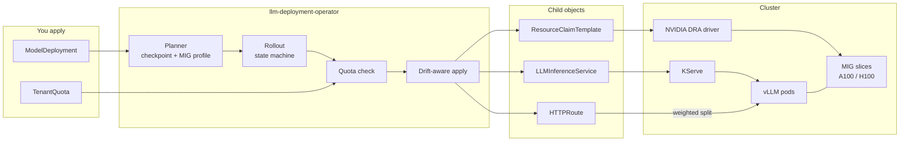
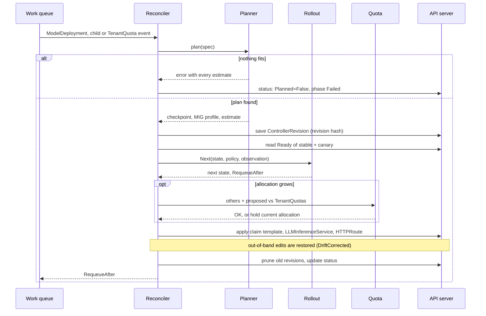
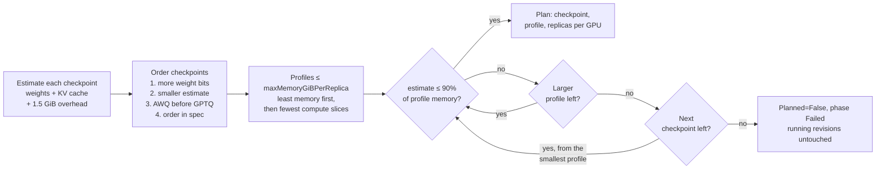
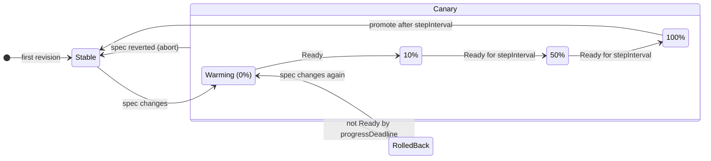
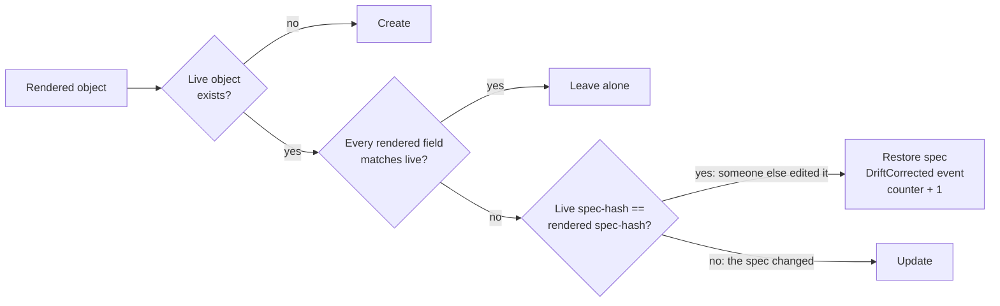

# llm-deployment-operator

A Kubernetes operator for platform teams that fits Llama and Qwen models onto NVIDIA MIG slices
and rolls them out on KServe with weighted canaries.

[](https://github.com/nitishsjsucs/llm-deployment-operator/actions/workflows/ci.yaml)
[](go.mod)
[](LICENSE)



> [!IMPORTANT]
> Unit- and fake-client-tested only (51 tests). Nothing has run on a live cluster with KServe, the
> NVIDIA DRA driver, a Gateway or vLLM. [What was and wasn't tested](docs/testing.md)

## Highlights

- **Memory-aware planner** — estimates weights + KV cache + overhead; picks the highest-precision checkpoint that fits.
- **Smallest MIG slice** — e.g. Llama-3.1-8B AWQ on `1g.20gb`, four replicas per A100-80GB.
- **DRA claims** — one `ResourceClaimTemplate` per revision pins the MIG profile and GPU model.
- **Canary rollouts** — warm-up at 0%, then 10 → 50 → 100% via `HTTPRoute`; auto promote or rollback.
- **Drift correction** — reverts out-of-band edits to owned objects and counts each one.
- **Per-tenant quota** — `TenantQuota` caps MIG slices per profile and total MIG memory, canaries included.

## Quickstart

No cluster needed: run the tests and the allocation calculator.

```sh
git clone https://github.com/nitishsjsucs/llm-deployment-operator.git
cd llm-deployment-operator
make test                                   # controller-gen, go fmt, go vet, go test ./...
go run ./cmd/packsim                        # sample fleet: whole GPUs vs MIG packing
go run ./cmd/packsim -explain llama-3.1-8b  # memory estimate per checkpoint
```

Deploying needs Kubernetes 1.34+, KServe, the NVIDIA DRA driver and Gateway API: see [docs/installing.md](docs/installing.md).

## How it works

### One reconcile pass



Rollout state lives in the `ModelDeployment` status, so every pass starts from what is stored.
`RequeueAfter` wakes the reconciler for the next timed step.

### Picking a checkpoint and MIG profile



For the sample, fp16 (24.46 GiB) fits no profile under the 20 GiB cap, so AWQ (14.83 GiB) lands on `1g.20gb`.
AWQ and GPTQ 4-bit tie on memory; AWQ-first is a fixed convention, not a quality claim. [Memory math](docs/design.md#memory-estimate)

### Canary rollout



The canary runs `ceil(replicas × weight / 100)` replicas next to the full stable set (10% of 4 → 1),
and drops to 0% the moment it stops being Ready. `strategy: Recreate` swaps revisions at once. [Rollout details](docs/rollouts.md)

### Drift correction



Only rendered fields are compared, so fields that KServe or webhooks add are left alone.
Claim templates are immutable, so they are deleted and recreated instead. [Drift strategy](docs/design.md#drift-correction)

## Results

<picture>
  <source media="(prefers-color-scheme: dark)" srcset="docs/images/llama-8b-memory-dark.svg">
  
</picture>

<picture>
  <source media="(prefers-color-scheme: dark)" srcset="docs/images/packsim-gpus-dark.svg">
  
</picture>

| Allocation | GPUs | Replicas | Estimates / GPU memory | MIG memory / GPU memory | Compute slices used |
|---|---|---|---|---|---|
| One replica per whole GPU | 20 | 20 | 26.6% | – | – |
| MIG-packed (first-fit decreasing) | 8 | 20 | 66.5% | 100.0% | 44 / 56 |

> Static allocation calculation by `cmd/packsim` for a made-up five-workload fleet, from the planner's
> estimates. No model was loaded; GPU utilization, throughput and latency were not measured. [Full output](docs/packsim.md)

## Example

```yaml
# config/samples/serving_v1alpha1_modeldeployment_llama.yaml (HF_TOKEN env omitted)
apiVersion: serving.llmops.dev/v1alpha1
kind: ModelDeployment
metadata: {name: llama-chat, namespace: team-a}
spec:
  tenant: team-a
  model:
    family: llama
    name: meta-llama/Llama-3.1-8B-Instruct
    catalogRef: llama-3.1-8b           # or spec.model.architecture
  variants:
    - {quantization: fp16, uri: hf://meta-llama/Llama-3.1-8B-Instruct}
    - {quantization: awq, uri: hf://hugging-quants/Meta-Llama-3.1-8B-Instruct-AWQ-INT4}
    - {quantization: gptq, bits: 4, uri: hf://hugging-quants/Meta-Llama-3.1-8B-Instruct-GPTQ-INT4}
  gpuBudget:
    gpuType: A100-80GB                 # A100-80GB | A100-40GB | H100-80GB
    maxMemoryGiBPerReplica: 20         # rules out 3g.40gb and larger
    maxModelLen: 8192
    maxConcurrentSequences: 8
  replicas: 4
  runtime:
    image: vllm/vllm-openai:v0.10.1
    extraArgs: ["--enable-prefix-caching"]
  rollout: {strategy: Canary, steps: [10, 50, 100], stepInterval: 5m, progressDeadline: 30m}
```

The reconciler's `Planned` condition for this sample:

```text
awq-int4 on 1g.20gb: estimated 14.83 GiB (weights 5.33, KV cache 8.00, overhead 1.50) of 17.55 GiB usable; 4 replicas per A100-80GB
```

The objects it renders are in [docs/design.md](docs/design.md#rendered-objects).

## Project layout

| Path | What |
|---|---|
| `api/v1alpha1` | `ModelDeployment` and `TenantQuota` types (group `serving.llmops.dev`) |
| `internal/planner`, `internal/packing` | Memory estimate, checkpoint + profile choice, MIG tables, first-fit-decreasing packing |
| `internal/rollout` | Canary / Recreate state machine (pure) |
| `internal/quota` | Quota arithmetic (pure) |
| `internal/render` | Builds the `ResourceClaimTemplate`, `LLMInferenceService` and `HTTPRoute` |
| `internal/controller` | Reconcilers, drift-aware apply, metrics, field indexes |
| `cmd/manager`, `cmd/packsim` | Operator entrypoint; static fleet allocation calculator |
| `config/`, `charts/` | Kustomize manifests, samples, Helm chart |

## Limitations

- One MIG instance per replica: no tensor parallelism, so fp16 70B cannot be planned.
- Static MIG partitioning only; the operator never creates or reshapes MIG instances.
- The memory estimate assumes a 16-bit KV cache and a fixed 1.5 GiB overhead; it was never checked against vLLM.
- Quota is checked in the reconciler, not an admission webhook, so status lag can let a brief overcommit through.
- Canary health is the `LLMInferenceService` `Ready` condition only; no error-rate or latency analysis.
- `/metrics` is plain HTTP with no authentication.

All known gaps: [docs/limitations.md](docs/limitations.md).

## Docs

| Page | What's in it |
|---|---|
| [design.md](docs/design.md) | Memory math, MIG tables and packing, DRA selectors, KServe and HTTPRoute shape, drift, quota |
| [rollouts.md](docs/rollouts.md) | Canary and Recreate transitions, timing, replica math, events |
| [api.md](docs/api.md) | Spec fields and defaults, status, conditions, events |
| [installing.md](docs/installing.md) | Prerequisites, image build, kustomize and Helm, manager flags |
| [packsim.md](docs/packsim.md) | The fleet calculator: inputs, full output, MIG layout, chart regeneration |
| [testing.md](docs/testing.md) | What was and wasn't tested, how to run the checks |
| [limitations.md](docs/limitations.md) | Every known gap |

## License

Apache License 2.0. See [LICENSE](LICENSE).
