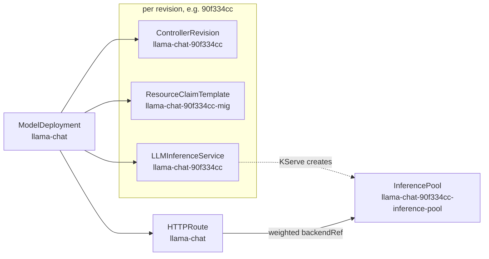
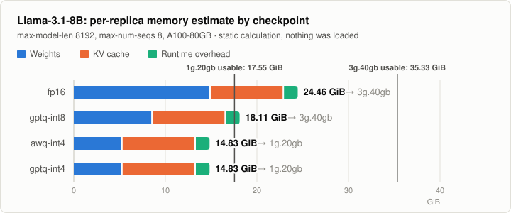
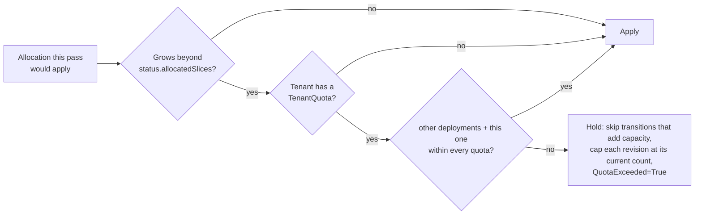

# Design

How the operator turns one `ModelDeployment` into a sized, routed, quota-checked set of objects.
Rollout behaviour has its own page: [rollouts.md](rollouts.md).

- [Revisions and child objects](#revisions-and-child-objects)
- [Memory estimate](#memory-estimate)
- [Choosing a checkpoint and profile](#choosing-a-checkpoint-and-profile)
- [MIG profiles and packing](#mig-profiles-and-packing)
- [DRA claims](#dra-claims)
- [KServe LLMInferenceService](#kserve-llminferenceservice)
- [Routing](#routing)
- [Rendered objects](#rendered-objects)
- [Drift correction](#drift-correction)
- [Per-tenant quota](#per-tenant-quota)

## Revisions and child objects

A **revision** is the first 8 hex characters of the SHA-256 of everything that is rolled out
(`render.Template`):

| In the revision hash | Not in it |
|---|---|
| model name, chosen checkpoint (quantization, bits, URI), GPU type, MIG profile, `maxModelLen`, `maxConcurrentSequences`, `--gpu-memory-utilization`, image, extra args, env | replica count (scaling happens in place), rollout and routing settings |



| Object | Name | Purpose | Triggers a reconcile? |
|---|---|---|---|
| `apps/v1` `ControllerRevision` | `<deployment>-<rev>` | Snapshot of the template, so the stable revision can still be rendered (and drift-corrected) while the spec moves on to a canary | No (read on demand; the cache only holds objects with the operator's label) |
| `resource.k8s.io/v1` `ResourceClaimTemplate` | `<deployment>-<rev>-mig` | One MIG instance of the planned profile per pod | Yes (`Owns`) |
| `serving.kserve.io/v1alpha1` `LLMInferenceService` | `<deployment>-<rev>` | vLLM workload; KServe creates the pods, the InferencePool and the endpoint picker | Yes (`Owns`) |
| `gateway.networking.k8s.io/v1` `HTTPRoute` | `<deployment>` | One per deployment; splits traffic between stable and canary | Yes (`Owns`) |

- Every child carries a controller owner reference to the `ModelDeployment`, so deleting it garbage-collects them (no finalizer).
- Labels: `serving.llmops.dev/deployment`, `serving.llmops.dev/tenant`, and `serving.llmops.dev/revision` on per-revision objects.
- Annotation `serving.llmops.dev/spec-hash`: the first 16 hex characters of the SHA-256 of the rendered spec, used for [drift detection](#drift-correction).
- Defaults are applied in memory; the reconciler writes only the `ModelDeployment` status subresource.
- If a revision's `ControllerRevision` is missing, that revision is dropped from the rollout state and logged.

## Memory estimate

For each checkpoint the planner (`internal/planner`) estimates the memory of one vLLM replica:

```text
weights   = params x 2 bytes                                           (fp16)
          = (params - embedding_params) x (bits + (16 + bits)/128) / 8
            + embedding_params x 2 bytes                               (AWQ / GPTQ)
kv_cache  = 2 x layers x kv_heads x head_dim x 2 bytes x maxModelLen x maxConcurrentSequences
overhead  = 1.5 GiB
estimate  = weights + kv_cache + overhead
fits      = estimate <= 0.90 x profile memory
```

| Term | What it assumes |
|---|---|
| `embedding_params` | `vocab_size x hidden_size`, doubled when the LM head is not tied. AWQ and GPTQ checkpoints keep the embedding and LM head in 16-bit. |
| `(16 + bits)/128` | Each weight's share of its group's 16-bit scale and packed zero point, at the usual group size of 128: 4-bit weights cost 4.15625 bits, 8-bit GPTQ weights 8.1875 bits. |
| `kv_cache` | Worst case: every concurrent sequence at `maxModelLen`, with vLLM's default 16-bit KV cache, so a replica never preempts at the configured load. |
| `overhead` | A fixed allowance for the CUDA context, the activation workspace vLLM profiles at startup, and CUDA graphs. An assumption, not a measurement; calibrate it for your vLLM version. |
| `0.90` | Also passed to vLLM as `--gpu-memory-utilization`, so vLLM turns memory above the estimate into extra KV cache blocks. |

### Built-in catalog

`spec.model.catalogRef` selects dimensions taken from each model's `config.json`. Other models are
described inline with `spec.model.architecture`.

| catalogRef | params | layers | KV heads | head dim | hidden | vocab | context |
|---|---|---|---|---|---|---|---|
| `llama-3.1-8b` | 8,030,261,248 | 32 | 8 | 128 | 4096 | 128,256 | 131,072 |
| `llama-3.1-70b` | 70,553,706,496 | 80 | 8 | 128 | 8192 | 128,256 | 131,072 |
| `qwen2.5-7b` | 7,615,616,512 | 28 | 4 | 128 | 3584 | 152,064 | 32,768 |
| `qwen2.5-14b` | 14,770,033,664 | 48 | 8 | 128 | 5120 | 152,064 | 32,768 |
| `qwen2.5-72b` | 72,706,203,648 | 80 | 8 | 128 | 8192 | 152,064 | 32,768 |

### Worked example: Llama-3.1-8B on an A100-80GB

<picture>
  <source media="(prefers-color-scheme: dark)" srcset="images/llama-8b-memory-dark.svg">
  
</picture>

Output of `go run ./cmd/packsim -explain llama-3.1-8b` (a static calculation; nothing is loaded):

```text
llama-3.1-8b on A100-80GB, max-model-len=8192 max-num-seqs=8
parameters: 8030261248, of which embedding + LM head (kept in 16-bit when quantized): 1050673152
KV cache: 2 x 32 layers x 8 KV heads x 128 head dim x 2 bytes = 131072 bytes/token, x 65536 tokens

VARIANT    WEIGHTS  KV CACHE  OVERHEAD  ESTIMATE  SMALLEST PROFILE  PROFILE USABLE  PER GPU
fp16       14.96    8.00      1.50      24.46     3g.40gb           35.33           2
gptq-int8  8.61     8.00      1.50      18.11     3g.40gb           35.33           2
awq-int4   5.33     8.00      1.50      14.83     1g.20gb           17.55           4
gptq-int4  5.33     8.00      1.50      14.83     1g.20gb           17.55           4
(memory in GiB; PROFILE USABLE is 90% of the profile's memory)
```

- 14.83 GiB is below 90% of the 19.5 GiB a `1g.20gb` instance provides (17.55 GiB) and above what `1g.10gb` offers (8.55 GiB).
- An A100-80GB holds at most four `1g.20gb` instances, so it hosts four replicas.
- fp16 (24.46 GiB) and 8-bit GPTQ (18.11 GiB) need `3g.40gb`; the sample's `maxMemoryGiBPerReplica: 20` excludes that profile, which is how it ends up on AWQ.

The same calculation for `qwen2.5-7b` (4 KV heads, so 56 KiB per token):

| Checkpoint | Estimate (GiB) | Smallest profile | Per A100-80GB |
|---|---|---|---|
| fp16 | 19.19 | `3g.40gb` | 2 |
| gptq-int8 | 13.25 | `1g.20gb` | 4 |
| awq-int4 / gptq-int4 | 10.19 | `1g.20gb` | 4 |

## Choosing a checkpoint and profile

1. **Candidate profiles** are the GPU's MIG profiles whose memory is at most `maxMemoryGiBPerReplica`
   (all of them when unset), ordered by memory, then compute slices, so `1g.20gb` beats `2g.20gb`.
2. **Checkpoints** are tried in this order; the first that fits a candidate wins, on the smallest profile it fits:
   1. more weight bits first (fp16, then 8-bit, then 4-bit);
   2. then the smaller estimate;
   3. then **AWQ before GPTQ**;
   4. then the order in `spec.variants`.
3. **Nothing fits**: the `Planned` condition is `False` with every checkpoint's estimate, the phase is `Failed`,
   and running revisions are left untouched.

AWQ and GPTQ at 4 bits get the same estimate, so rule 3 decides between them. It is a fixed
convention that keeps plans stable across reconciles, not a claim that one method is better; list
only the checkpoint you want if you prefer GPTQ.

Planning also fails (same `Failed` path) on invalid rollout steps, a bit width the quantization does
not support, a `catalogRef` whose family does not match `spec.model.family`, and a `maxModelLen`
above the model's context window.

## MIG profiles and packing

`internal/packing` holds compute-only profile tables (the `+me` media variants are omitted). Every
GPU has 7 compute slices and 8 memory slices. "Usable GiB" is roughly what `nvidia-smi mig -lgip`
reports; it varies slightly by driver.

| A100-80GB | compute | memory slices | usable GiB | max per GPU | placements |
|---|---|---|---|---|---|
| `1g.10gb` | 1 | 1 | 9.5 | 7 | 0–6 |
| `1g.20gb` | 1 | 2 | 19.5 | 4 | 0, 2, 4, 6 |
| `2g.20gb` | 2 | 2 | 19.5 | 3 | 0, 2, 4 |
| `3g.40gb` | 3 | 4 | 39.25 | 2 | 0, 4 |
| `4g.40gb` | 4 | 4 | 39.25 | 1 | 0 |
| `7g.80gb` | 7 | 8 | 78.75 | 1 | 0 |

<details>
<summary>A100-40GB and H100-80GB tables</summary>

| A100-40GB | compute | memory slices | usable GiB | max per GPU | placements |
|---|---|---|---|---|---|
| `1g.5gb` | 1 | 1 | 4.75 | 7 | 0–6 |
| `1g.10gb` | 1 | 2 | 9.62 | 4 | 0, 2, 4, 6 |
| `2g.10gb` | 2 | 2 | 9.62 | 3 | 0, 2, 4 |
| `3g.20gb` | 3 | 4 | 19.62 | 2 | 0, 4 |
| `4g.20gb` | 4 | 4 | 19.62 | 1 | 0 |
| `7g.40gb` | 7 | 8 | 39.5 | 1 | 0 |

| H100-80GB | compute | memory slices | usable GiB | max per GPU | placements |
|---|---|---|---|---|---|
| `1g.10gb` | 1 | 1 | 9.75 | 7 | 0–6 |
| `1g.20gb` | 1 | 2 | 19.62 | 4 | 0, 2, 4, 6 |
| `2g.20gb` | 2 | 2 | 19.62 | 3 | 0, 2, 4 |
| `3g.40gb` | 3 | 4 | 39.5 | 2 | 0, 4 |
| `4g.40gb` | 4 | 4 | 39.5 | 1 | 0 |
| `7g.80gb` | 7 | 8 | 79.25 | 1 | 0 |

</details>

`Pack` (first-fit decreasing):

- sorts requests by memory slices, then compute slices (both descending), then ID, so results are deterministic;
- puts each request on the first GPU with a free valid placement, enough compute slices and room under the profile's instance limit;
- opens a new GPU otherwise.

The operator itself never places MIG instances (the DRA scheduler does). Packing is used by
[`cmd/packsim`](packsim.md) to compare allocation schemes.

## DRA claims

Each revision gets a `resource.k8s.io/v1` `ResourceClaimTemplate` (the DRA API that is GA in
Kubernetes 1.34, built against the `k8s.io/api` v0.34 types).

| Piece | Value |
|---|---|
| Request | exactly one device (`allocationMode: ExactCount`, `count: 1`) |
| DeviceClass | `mig.nvidia.com`, created by NVIDIA's [k8s-dra-driver-gpu](https://github.com/NVIDIA/k8s-dra-driver-gpu) for MIG devices |
| Selector 1 | `device.attributes['gpu.nvidia.com'].profile == '<profile>'` pins the MIG profile |
| Selector 2 | `device.attributes['gpu.nvidia.com'].productName.matches('<pattern>')` pins the GPU model |
| Pod wiring | `spec.template.resourceClaims` references the template; the `main` container lists it in `resources.claims`; DRA creates one `ResourceClaim` per pod |

**Why pin `productName`:** the same profile name (for example `1g.20gb`) exists on both A100-80GB
and H100-80GB with different performance. The patterns are `A100.*80GB`, `A100.*40GB` and `H100`.

Assumptions to check against your driver:

- The attribute names (`profile`, `productName`) come from the driver's MIG device attributes but were not verified against a running driver. If yours differ, change `MIGSelectors` in `internal/render/render.go`.
- MIG instances must already exist on the node (static partitioning, for example via the GPU operator's MIG manager).

## KServe LLMInferenceService

`LLMInferenceService` (`serving.kserve.io/v1alpha1`) is built as `unstructured.Unstructured`; the
operator does not import KServe's Go module.

| Field | Value |
|---|---|
| `spec.model.uri`, `spec.model.name` | chosen checkpoint URI; `spec.model.name` from the ModelDeployment |
| `spec.replicas` | replicas for this revision (stable: `spec.replicas`; canary: see [rollouts.md](rollouts.md#replicas-and-weights)) |
| `spec.router.scheduler` | `{}`, so KServe creates the InferencePool and endpoint picker |
| `spec.router.gateway.refs` | the Gateway from `spec.routing.gateway` |
| `spec.router.route.http.refs` | the operator's HTTPRoute, so KServe does not create its own |
| `spec.template` | pod spec: `main` container (`vllm serve /mnt/models`) plus the DRA claim |

vLLM arguments, followed by `runtime.extraArgs`:

| Argument | Value |
|---|---|
| `--served-model-name`, `--port` | `spec.model.name`, `8000` |
| `--quantization` | `awq_marlin` for AWQ, `gptq_marlin` for GPTQ, omitted for fp16 (all supported GPUs are Ampere or newer; plain `awq`/`gptq` would select slower kernels) |
| `--max-model-len` | `gpuBudget.maxModelLen` |
| `--max-num-seqs` | `gpuBudget.maxConcurrentSequences` |
| `--gpu-memory-utilization` | `0.90` |

- The operator sets the full command and argument list, because container args are replaced, not merged, when KServe merges the template with its `LLMInferenceServiceConfig`.
- If your KServe setup serves vLLM over TLS, add `--ssl-certfile` / `--ssl-keyfile` through `runtime.extraArgs`.
- If your default `LLMInferenceServiceConfig` sets `nvidia.com/gpu` limits, remove them: the pod should get its GPU from the DRA claim, not the device plugin.
- With `runtime.image` empty, the image from KServe's `LLMInferenceServiceConfig` is used.

## Routing

| Aspect | Behaviour |
|---|---|
| Parent | Gateway from `spec.routing.gateway` (default `kserve/kserve-ingress-gateway`); optional `spec.routing.hostnames` |
| Match | `PathPrefix /<namespace>/<deployment>`, rewritten to `/` (`ReplacePrefixMatch`) |
| Backends | InferencePools named `<llminferenceservice>-inference-pool` in group `inference.networking.k8s.io` |
| Weights | stable `100 - w`, canary `w`; the canary backend is listed only while `w > 0` |
| Created | once the stable revision is running (not while quota holds a new deployment back) |

- Clients call `/<namespace>/<deployment>/v1/chat/completions`; the served model name and OpenAI paths stay the same across revisions.
- For KServe versions that still use `inference.networking.x-k8s.io`, set `--inference-pool-api-group` (Helm value `inferencePoolAPIGroup`).
- The InferencePool name suffix is an assumption about KServe's naming, not verified against a running KServe.

## Rendered objects

Output of `internal/render` for the [llama sample](../config/samples/serving_v1alpha1_modeldeployment_llama.yaml),
revision `90f334cc` (labels, annotations and owner references omitted). The HTTPRoute is shown at the
10% canary step after the image changes to `vllm/vllm-openai:v0.11.0` (revision `db45f654`).

<details>
<summary>ResourceClaimTemplate, LLMInferenceService and HTTPRoute (70 lines)</summary>

```yaml
apiVersion: resource.k8s.io/v1
kind: ResourceClaimTemplate
metadata:
  name: llama-chat-90f334cc-mig
  namespace: team-a
spec:
  spec:
    devices:
      requests:
      - name: mig
        exactly:
          deviceClassName: mig.nvidia.com
          allocationMode: ExactCount
          count: 1
          selectors:
          - cel:
              expression: device.attributes['gpu.nvidia.com'].profile == '1g.20gb'
          - cel:
              expression: device.attributes['gpu.nvidia.com'].productName.matches('A100.*80GB')
---
apiVersion: serving.kserve.io/v1alpha1
kind: LLMInferenceService
metadata:
  name: llama-chat-90f334cc
  namespace: team-a
spec:
  model:
    name: meta-llama/Llama-3.1-8B-Instruct
    uri: hf://hugging-quants/Meta-Llama-3.1-8B-Instruct-AWQ-INT4
  replicas: 4
  router:
    gateway:
      refs: [{name: kserve-ingress-gateway, namespace: kserve}]
    route:
      http:
        refs: [{name: llama-chat}]   # the operator's HTTPRoute; KServe does not create its own
    scheduler: {}                    # KServe creates the InferencePool and endpoint picker
  template:
    containers:
    - name: main
      image: vllm/vllm-openai:v0.10.1
      command: [vllm, serve, /mnt/models]
      args: [--served-model-name, meta-llama/Llama-3.1-8B-Instruct, --port, "8000",
             --quantization, awq_marlin, --max-model-len, "8192", --max-num-seqs, "8",
             --gpu-memory-utilization, "0.90", --enable-prefix-caching]
      env:
      - name: HF_TOKEN
        valueFrom: {secretKeyRef: {key: token, name: hf-token}}
      resources:
        claims: [{name: mig}]
    resourceClaims:
    - name: mig
      resourceClaimTemplateName: llama-chat-90f334cc-mig
---
apiVersion: gateway.networking.k8s.io/v1
kind: HTTPRoute
metadata:
  name: llama-chat
  namespace: team-a
spec:
  parentRefs:
  - {group: gateway.networking.k8s.io, kind: Gateway, name: kserve-ingress-gateway, namespace: kserve}
  rules:
  - matches:
    - path: {type: PathPrefix, value: /team-a/llama-chat}
    filters:
    - type: URLRewrite
      urlRewrite: {path: {type: ReplacePrefixMatch, replacePrefixMatch: /}}
    backendRefs:
    - {group: inference.networking.k8s.io, kind: InferencePool, name: llama-chat-90f334cc-inference-pool, weight: 90}
    - {group: inference.networking.k8s.io, kind: InferencePool, name: llama-chat-db45f654-inference-pool, weight: 10}
```

</details>

## Drift correction

Children are reconciled with get, compare and update (field manager `llm-deployment-operator`).
The README has the [decision diagram](../README.md#drift-correction).

| Situation | What the operator does | Counted as drift? |
|---|---|---|
| Child missing | Creates it | No |
| Every rendered field matches live (maps recursively, lists element by element, numbers by value) | Nothing; extra fields from KServe, webhooks or other controllers are left alone | No |
| An owned field differs and the live `spec-hash` equals the rendered one | Writes the rendered spec back | **Yes**: `DriftCorrected` Warning event and `llmdeploy_drift_corrections_total{kind}` +1 |
| An owned field differs because the spec changed (e.g. scaling) | Writes the rendered spec back | No |
| `ResourceClaimTemplate` differs | Deletes (with a UID precondition) and recreates it, since its spec is immutable | Yes, when the spec-hash is unchanged |

- `kind` is `LLMInferenceService`, `HTTPRoute` or `ResourceClaimTemplate`.
- An update replaces the whole `spec`, so fields other writers added to `spec` are dropped at that point (defaulting webhooks add theirs back). Labels and annotations are merged.
- Server-side apply would merge instead; it was not used so that the update semantics are the ones the fake-client tests exercise.

## Per-tenant quota

A cluster-scoped `TenantQuota` limits MIG instances per profile and/or total MIG memory for a
tenant, counting every revision, canaries included:

```yaml
apiVersion: serving.llmops.dev/v1alpha1
kind: TenantQuota
metadata:
  name: team-a
spec:
  tenant: team-a
  migSlices:
    - {profile: 1g.20gb, max: 8}
    - {profile: 3g.40gb, max: 2}
  maxGPUMemoryGiB: 160    # nominal: 20 per 1g.20gb, 40 per 3g.40gb, 80 per 7g.80gb
```



| Rule | Detail |
|---|---|
| What counts | `status.allocatedSlices` of every `ModelDeployment` with the same `spec.tenant` (both types are indexed by tenant) |
| Memory | Nominal size parsed from the profile name (`1g.20gb` → 20 GiB) |
| Unlisted profiles | Bound only by `maxGPUMemoryGiB` |
| No `TenantQuota` | The tenant is not limited |
| Several quotas | Every one is checked |
| Held back | Nothing is created for a new deployment; running revisions keep their replica count; a canary does not start or advance |
| Decreases | Always applied; lowering a quota never evicts running replicas |
| Retry | Any `TenantQuota` change (spec or status) requeues the tenant's deployments |

An example `QuotaExceeded` message:
`TenantQuota team-a: 1g.20gb slices would be 8 (this deployment 4 + other deployments 4), limit 6`.

The `TenantQuota` reconciler keeps `status.usedSlices`, `status.usedGPUMemoryGiB` and
`status.deployments` current. A canary needs headroom for its extra replicas (up to `replicas` more
at the 100% step); use `strategy: Recreate` for a tenant that runs at its limit.
