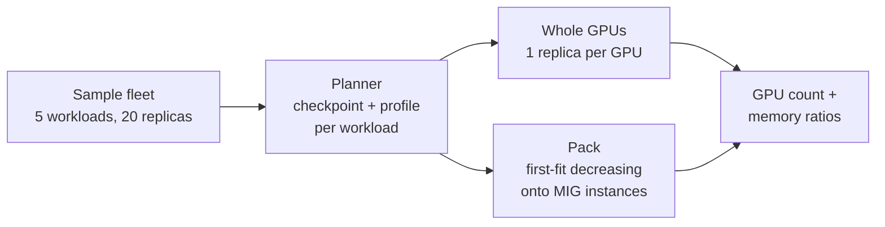
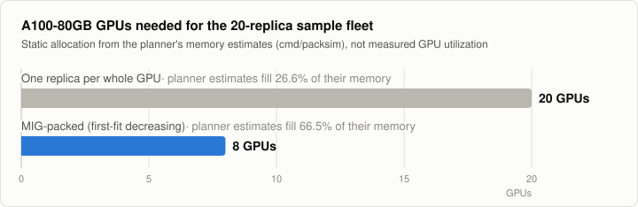

# packsim: fleet allocation calculator

`cmd/packsim` asks how many GPUs a fleet needs when every replica gets a whole GPU, and how many it
needs when replicas share GPUs through the MIG profiles the planner picks.

> [!NOTE]
> This is a **static allocation calculation** from the planner's memory estimates and the MIG
> tables. No model is loaded, no inference runs, and no GPU utilization, throughput or latency is
> measured.



## Usage

```sh
go run ./cmd/packsim                          # the sample fleet (same as make packsim)
go run ./cmd/packsim -explain llama-3.1-8b    # per-checkpoint estimate for one catalog model
go run ./cmd/packsim -gpu H100-80GB -max-model-len 4096 -max-num-seqs 16
```

| Flag | Default | Meaning |
|---|---|---|
| `-gpu` | `A100-80GB` | `A100-40GB`, `A100-80GB` or `H100-80GB` (the sample fleet's 70B and 72B workloads do not fit an A100-40GB, so that run exits with a no-fit error) |
| `-max-model-len` | `8192` | context length per sequence |
| `-max-num-seqs` | `8` | concurrent sequences per replica |
| `-explain` | – | print the estimate of fp16, gptq-int8, awq-int4 and gptq-int4 for one catalog model instead |

## The sample fleet

An illustrative mix defined in [`cmd/packsim/main.go`](../cmd/packsim/main.go); it does not model a real workload.

| Workload | Catalog model | Replicas | Checkpoints offered | Budget per replica |
|---|---|---|---|---|
| `llama-3.1-8b-chat` | `llama-3.1-8b` | 8 | fp16, AWQ, GPTQ 4-bit | 20 GiB |
| `qwen2.5-7b-assistant` | `qwen2.5-7b` | 6 | fp16, AWQ | 20 GiB |
| `qwen2.5-14b-rag` | `qwen2.5-14b` | 3 | fp16, GPTQ 4-bit | 40 GiB |
| `llama-3.1-70b-reasoning` | `llama-3.1-70b` | 2 | AWQ | none |
| `qwen2.5-72b-batch` | `qwen2.5-72b` | 1 | GPTQ 4-bit | none |

## Results

<picture>
  <source media="(prefers-color-scheme: dark)" srcset="images/packsim-gpus-dark.svg">
  
</picture>

Output of `go run ./cmd/packsim` (A100-80GB, `max-model-len=8192`, `max-num-seqs=8`):

```text
WORKLOAD                 REPLICAS  VARIANT    WEIGHTS  KV CACHE  OVERHEAD  ESTIMATE  MIG PROFILE  PER GPU
llama-3.1-8b-chat        8         awq-int4   5.33     8.00      1.50      14.83     1g.20gb      4
qwen2.5-7b-assistant     6         awq-int4   5.19     3.50      1.50      10.19     1g.20gb      4
qwen2.5-14b-rag          3         gptq-int4  9.29     12.00     1.50      22.79     3g.40gb      2
llama-3.1-70b-reasoning  2         awq-int4   37.03    20.00     1.50      58.53     7g.80gb      1
qwen2.5-72b-batch        1         gptq-int4  38.61    20.00     1.50      60.11     7g.80gb      1
(memory in GiB)

ALLOCATION                         GPUS  REPLICAS  ESTIMATE / GPU MEMORY  MIG MEMORY / GPU MEMORY  COMPUTE SLICES IN USE
one replica per whole GPU          20    20        26.6%                  -                        -
MIG-packed (first-fit decreasing)  8     20        66.5%                  100.0%                   44/56
```

| Column | Definition |
|---|---|
| ESTIMATE / GPU MEMORY | sum of per-replica estimates ÷ total memory of the GPUs needed |
| MIG MEMORY / GPU MEMORY | nominal memory of the allocated MIG instances ÷ total memory of the GPUs needed |
| COMPUTE SLICES IN USE | compute slices of the allocated instances ÷ (7 × GPUs needed) |

### MIG layout

Instance placement by memory-slice offset (`profile@offset replica`):

| GPU | Instances |
|---|---|
| gpu0 | `7g.80gb@0` llama-3.1-70b-reasoning/0 |
| gpu1 | `7g.80gb@0` llama-3.1-70b-reasoning/1 |
| gpu2 | `7g.80gb@0` qwen2.5-72b-batch/0 |
| gpu3 | `3g.40gb@0` qwen2.5-14b-rag/0, `3g.40gb@4` qwen2.5-14b-rag/1 |
| gpu4 | `3g.40gb@0` qwen2.5-14b-rag/2, `1g.20gb@4` llama-3.1-8b-chat/0, `1g.20gb@6` llama-3.1-8b-chat/1 |
| gpu5 | `1g.20gb@0,2,4,6` llama-3.1-8b-chat/2–5 |
| gpu6 | `1g.20gb@0,2` llama-3.1-8b-chat/6–7, `1g.20gb@4,6` qwen2.5-7b-assistant/0–1 |
| gpu7 | `1g.20gb@0,2,4,6` qwen2.5-7b-assistant/2–5 |

## How to read the numbers

- For this made-up fleet, whole-GPU allocation needs 20 GPUs and the planner's estimates add up to 26.6% of their memory.
- Packing the same replicas onto MIG instances needs 8 GPUs, and the same estimates add up to 66.5% of those GPUs' memory.
- This is arithmetic over the estimates and the MIG tables. It says nothing about achieved throughput, latency or measured utilization.
- In practice vLLM on a whole GPU would also reserve 90% of it for KV cache; the comparison counts only the memory the configured load needs.
- The operator does not place MIG instances itself; on a cluster the DRA scheduler decides placement.

## Regenerating the charts

The README charts come from [`results/packsim.json`](results/packsim.json), which holds the parsed
output of the two commands above. [`charts.py`](charts.py) uses only the Python standard library:

```sh
python3 docs/charts.py --refresh   # re-run packsim, rewrite the JSON, render docs/images/*.svg
python3 docs/charts.py             # render from the committed JSON only
```
