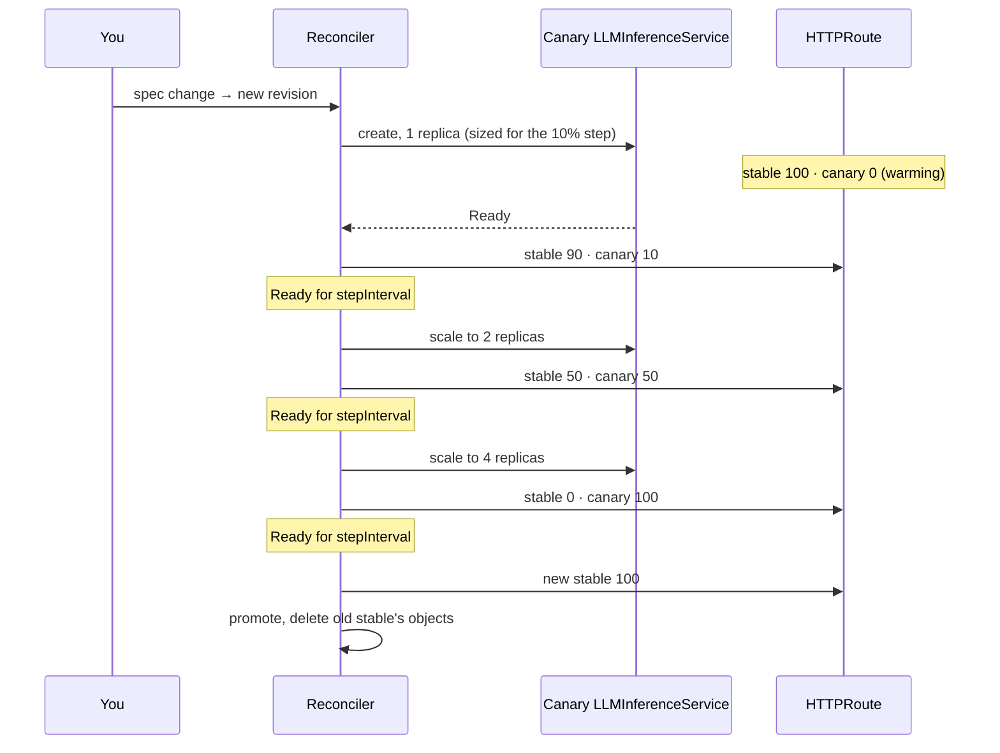

# Rollouts

The rollout logic is a pure state machine (`rollout.Next` in `internal/rollout`). The reconciler
stores its state in the `ModelDeployment` status, turns the decision into objects, and requeues
with `RequeueAfter` for the next timed transition. Canary readiness changes arrive through the
`Owns()` watch on `LLMInferenceService`.

## A canary from start to promotion

Default settings (`steps: [10, 50, 100]`, `stepInterval: 5m`) with `replicas: 4`, after the image changes:

From the moment the canary is Ready, promotion takes at least `len(steps) × stepInterval`
(15 minutes with the defaults).

## Transitions

| Action | When | Next state | Requeue after | Event |
|---|---|---|---|---|
| Initialize | no stable revision yet | the desired revision becomes stable directly | – | `Deployed` |
| None | spec matches the stable revision, no canary | unchanged | – | – |
| Recreate | new revision, `strategy: Recreate` | the new revision replaces the stable one at once | – | `Recreated` |
| StartCanary | new revision (or a third one replacing an in-flight canary) | canary warming, `canaryStep: -1`, 0% | `progressDeadline` | `CanaryStarted` |
| Wait | canary not Ready, deadline not reached | unchanged; canary weight 0 | time left to the deadline | – |
| Advance | warming canary turns Ready, or a step held Ready for `stepInterval` | next step, step clock restarts | `stepInterval` | `CanaryAdvanced` |
| Wait | canary Ready, `stepInterval` not over | unchanged | time left in the interval | – |
| Promote | last step (100%) held Ready for `stepInterval` | canary becomes stable; old stable's `LLMInferenceService`, `ResourceClaimTemplate` and `ControllerRevision` are deleted | – | `CanaryPromoted` |
| Rollback | canary not Ready within `progressDeadline` of the warm-up or current step start | canary weight 0, its objects deleted, `RolledBack=True` | – | `RolledBack` (Warning) |
| Hold | spec still produces the rolled-back revision | unchanged; nothing is rolled out | – | – |
| Abort | spec reverted to the stable revision while a canary runs | canary removed | – | `CanaryAborted` |

- Reverting the spec after a rollback returns to plain `Stable` and clears `RolledBack`.
- A rolled-back revision is retried only after the spec changes to a different revision.
- If `steps` is shortened mid-rollout, the current step is clamped to the last one.
- When the tenant's quota is exceeded, transitions that add capacity (Initialize, Recreate, StartCanary,
  Advance) are not taken and record no event. See [design.md](design.md#per-tenant-quota).

## Replicas and weights

The canary runs `ceil(replicas × weight / 100)` replicas (at least one, at most `replicas`) for the
weight of its step; a warming canary is sized for the first step. The stable revision keeps all of
its replicas until promotion.

| Phase (`replicas: 4`) | Canary replicas | Canary weight | Stable replicas | MIG instances held |
|---|---|---|---|---|
| Warming | 1 | 0% | 4 | 5 |
| 10% | 1 | 10% | 4 | 5 |
| 50% | 2 | 50% | 4 | 6 |
| 100% | 4 | 100% | 4 | 8 |
| Promoted | – | – | 4 (new revision) | 4 |

- A canary that stops being Ready gets weight 0 immediately; it keeps its step and replicas until it recovers or the deadline passes.
- Advancing a step raises the canary's replica count and its weight in the same reconcile.

## Persisted state

| Status field | Meaning |
|---|---|
| `stableRevision` | revision serving production traffic |
| `canaryRevision` | revision being rolled out, empty when none |
| `canaryStep` | index into `spec.rollout.steps`, or `-1` while warming |
| `canaryStepStartTime` | when the current step (or warm-up) began; the deadline and interval count from here |
| `canaryWeight` | current canary traffic percentage |
| `rolledBackRevision` | last rolled-back revision; not retried until the spec changes |

## Recreate

With `strategy: Recreate` the new revision's objects are created and the old revision's are
pruned in the same reconcile. There is no overlap, so traffic has nowhere to go until the new
revision is Ready; use it when quota leaves no room for a canary.
