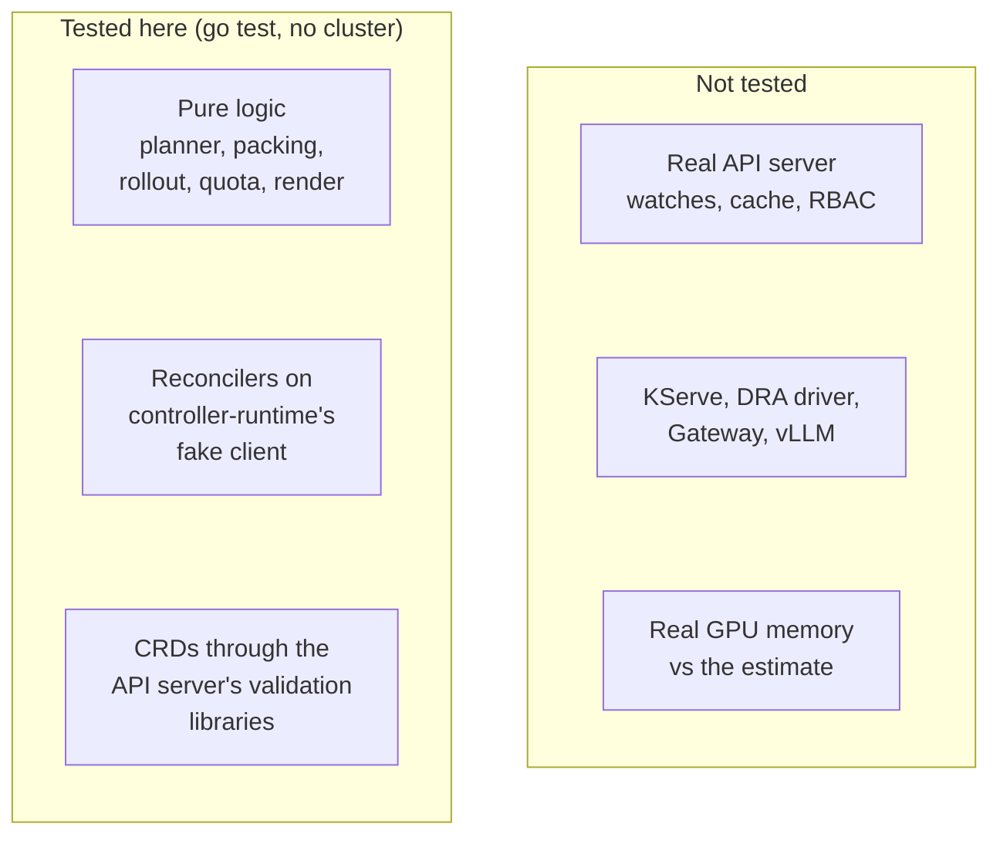

# Testing

> [!IMPORTANT]
> Everything below runs without a cluster. Nothing has been run against a real API server, KServe,
> the NVIDIA DRA driver, a Gateway implementation, vLLM or a GPU.

## What was tested

`go test ./...` passes: 51 top-level tests and 69 table-driven subtests.

| Package | Tests (subtests) | What they cover |
|---|---|---|
| `internal/planner` | 6 (22) | KV cache bytes per token for every catalog model; fp16 / AWQ / GPTQ int4 / int8 weight sizes; the 14.83 GiB Llama-3.1-8B AWQ estimate; 18 selection cases incl. AWQ on `1g.20gb` with four per A100-80GB, the AWQ/GPTQ tie-break, budgets, A100-40GB, H100-80GB and no-fit errors |
| `internal/packing` | 7 (11) | instance limits for every profile of the three GPUs, table consistency, eleven packing cases (placement offsets, mixed profiles), determinism, unknown profiles, nominal memory from profile names |
| `internal/rollout` | 5 (16) | every state-machine transition, a full 10/50/100 progression, step validation, weights |
| `internal/quota` | 3 (7) | usage arithmetic, increase detection, per-profile and memory limits, several quotas |
| `internal/render` | 6 | vLLM arguments per quantization, the claim template and its CEL selectors, LLMInferenceService fields, HTTPRoute, readiness parsing, revision hashing |
| `internal/controller` | 17 (3) | see below |
| `api/v1alpha1` | 4 (10) | generated CRDs pass the API server's CRD validation (incl. CEL compilation and cost limits); samples pass OpenAPI validation, defaulting and CEL rules; invalid objects are rejected with the expected messages |
| `cmd/packsim` | 3 | sample-fleet output, `-explain` output, unknown models |

Reconciler tests on controller-runtime's fake client:

- initial create of `LLMInferenceService`, `ResourceClaimTemplate`, `HTTPRoute`, `ControllerRevision` and status;
- plan failure; quota exceeded on create and on scale-up, recovery when the quota is raised, scale-down while over quota;
- canary progression through 10/50/100 with replica and weight checks, then promotion;
- rollback when a canary that lost readiness misses the deadline, no retry of the rolled-back revision;
- abort on revert; the Recreate strategy;
- drift correction of all three child kinds with the counter and events, with no false positives for added fields or spec changes;
- `TenantQuota` status;
- helpers: defaulting, catalog vs inline architecture, revision hash ignoring replicas, rejected steps, both samples planning, quota capping, canary replica math, the field-subset comparison.

Other checks, all passing:

| Check | Result |
|---|---|
| `golangci-lint run` (v2.5.0) | 0 issues |
| `make verify-generated` | CRDs, RBAC, deepcopy and chart copies up to date |
| `kustomize build config/default` (v5.7.1) | renders CRDs, RBAC, Deployment, Service, Namespace |
| `helm lint charts/llm-deployment-operator` | passes |
| `helm template … --kube-version 1.34.0` | renders (the chart requires Kubernetes ≥ 1.34, so a plain `helm template` refuses) |

## What was not tested

| Area | Why | What could be wrong |
|---|---|---|
| Real API server | envtest binaries could not be downloaded and no cluster was available | watches, the informer cache, field indexes in a real cache, leader election, RBAC sufficiency |
| KServe | not installed | the `LLMInferenceService` field layout, the `-inference-pool` naming, how KServe merges the pod template |
| NVIDIA DRA driver | no GPUs or driver | the attribute names `profile` / `productName`, the `mig.nvidia.com` DeviceClass |
| Gateway implementation | not installed | HTTPRoute acceptance, weighted InferencePool backends |
| vLLM | no GPUs | the command line; the memory estimate vs real usage (the 1.5 GiB overhead is an assumption) |
| Container image | no Docker daemon was available | the `Dockerfile` build and the distroless runtime |

## Running the checks

| Command | What it runs |
|---|---|
| `make test` | `controller-gen` (CRDs, RBAC, deepcopy), `go fmt`, `go vet`, `go test ./... -coverprofile cover.out` |
| `make lint` | `golangci-lint` |
| `make build` | `bin/manager` and `bin/packsim` |
| `make verify-generated` | fails if generated files or the chart copies are stale |
| `make packsim` | `go run ./cmd/packsim` |

Tools (controller-gen v0.19.0, golangci-lint v2.5.0, kustomize v5.7.1) are installed into `./bin`
with `go install`. The project builds with Go 1.24 against controller-runtime v0.22.5 and
`k8s.io/*` v0.34.3.

CI ([`.github/workflows/ci.yaml`](../.github/workflows/ci.yaml)) runs on pushes to `main` and on pull requests:

| Job | Steps |
|---|---|
| Build and test | `go build ./...`, `go vet ./...`, `go test ./...`, `make verify-generated` |
| Lint | `golangci-lint` v2.5.0 |
